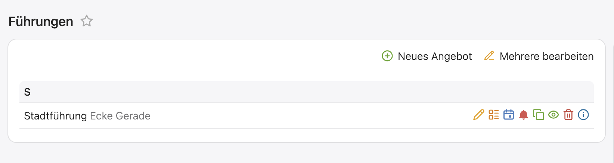
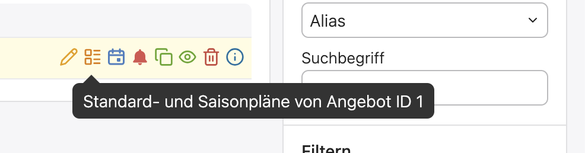
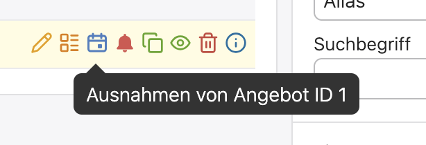
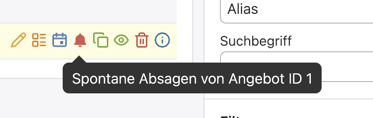
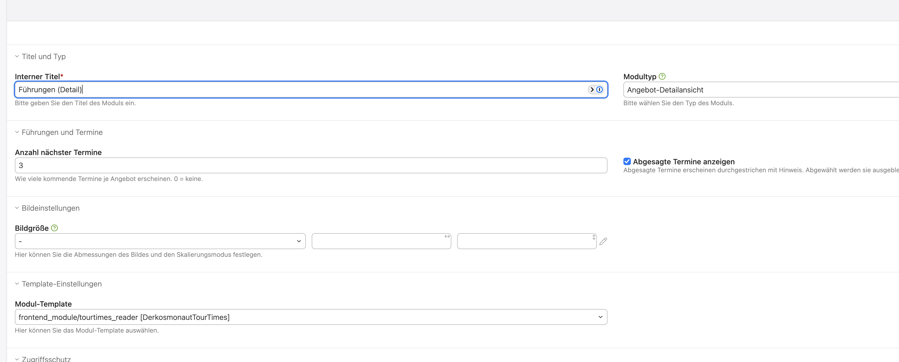

<p align="center"></p>

# tourtimes_contao

*** Release Candidate: im Einsatz getestet, aber noch nicht als stabil gekennzeichnet ***

Regelmäßig wiederkehrende Termine wie Führungen für Contao (Bundle für Contao 5.7 oder neuer, PHP 8.5).
Schwester-Erweiterung von [opentimes_contao](https://github.com/derkosmonaut/opentimes_contao), gleiche Logik
für Pläne, Saisons und Ausnahmen, aber für einzelne Termine statt Öffnungsfenster.

## Funktionsumfang

- Beliebig viele **Angebote** (z. B. Führungen) mit Beschreibung, Bild, Treffpunkt, Dauer, Preis, Sprache und Ticketlink
- **Feste Startzeit oder Zeitfenster** je Angebot: Führungen beginnen zur Uhrzeit, Audioguides o. Ä. lassen sich
  jederzeit im Zeitfenster starten (z. B. 10–12 Uhr) und bleiben bis zum Ende sichtbar
- **Zeitraum je Angebot**: „Termine ab“, „Termine bis“ und „Endet nach X Terminen“, z. B. eine Sommerführung
  an fünf Montagen; danach verschwindet das Angebot von selbst aus der Liste
- **Standard- und Saisonpläne** je Angebot (Zeitraum, jährlich wiederholbar, Priorität)
- **Zeitslots** je Plan, z. B. „Mo, Di, Mi 10:00–11:00“, optional mit festem Hinweis („auf Englisch“)
- **Ausnahmen** für Tage oder Zeiträume, für das ganze Angebot oder einzelne Slots:
  Ausfall, andere Uhrzeit, Hinweis (z. B. „Treffpunkt verlegt“) und Zusatztermin
- **Spontane Absagen** mit Hinweistext, für das ganze Angebot oder einzelne Slots, bis auf Weiteres oder mit Ende
- Drei Frontend-Module:
  - **Angebotsliste**: alle Angebote mit regelmäßigen Zeiten und den nächsten Terminen
  - **Termine heute**: die heutigen Termine chronologisch; ein Termin verschwindet, sobald er beginnt,
    mit einstellbarem **Versatz** entsprechend früher (z. B. 10 Minuten für den Infomonitor an der Kasse)
  - **Detailansicht**: ein Angebot mit allen Angaben und den nächsten Terminen
- **Feiertage**: je Angebot ein Bundesland wählen, an gesetzlichen Feiertagen entfallen die regulären Termine
- **Vorschau im Backend** beim Angebot: die nächsten Termine mit Zustand und Hinweisen auf Unstimmigkeiten
- **Sitemap**: Detailseiten der Angebote erscheinen in der Contao-Sitemap
- **Strukturierte Daten**: angezeigte Termine als schema.org-Events (JSON-LD), abgesagte als abgesagt
- Twig-Templates, Grundstil mit CSS-Variablen, deutsche und englische Texte

## Auflösungsreihenfolge

Die speziellere Ebene schlägt die allgemeinere:

0. Zeitraum des Angebots (außerhalb gibt es keine Termine)
1. Spontane Absage (schlägt alles, auch Zusatztermine)
2. Ausnahme (Verschiebung oder Hinweis bestätigen einen Termin auch am Feiertag; Ausfall schlägt Verschiebung, Hinweise werden gesammelt, Zusatztermine kommen hinzu)
3. Feiertag (keine regulären Termine, sofern beim Angebot ein Bundesland gewählt ist)
4. Saisonplan (ersetzt den Standardplan vollständig, höhere Priorität gewinnt)
5. Standardplan

## Anwendung

**1. Angebot anlegen.** Unter „Inhalte → Führungen“ ein Angebot mit Titel, Texten und Details anlegen.
Die Dauer gilt für alle Termine ohne eigenes Ende.

Unter „Art der Termine“ wählst du zwischen **fester Startzeit** (z. B. Führung) und **Zeitfenster** (z. B. Audioguide).
Bei Zeitfenstern:

- erscheint überall der Zeitraum, z. B. „10:00–12:00 Uhr · Start jederzeit“, während er läuft „jetzt möglich bis 12:00 Uhr“
- verschwindet der Termin erst am Ende; der Versatz zählt vom Ende rückwärts (10 Minuten = letzter Start 11:50)
- gilt ein Fenster als abgesagt, sobald eine spontane Absage es berührt
- braucht jeder Zeitslot ein Ende; die Dauer ist dann nur eine Angabe für Besucher
Unter „Zeitraum“ lässt sich das Angebot begrenzen: „Termine ab“ und „Termine bis“ und/oder „Endet nach X Terminen“
(gezählt ab „Termine ab“; jeder Termin zählt, auch abgesagte und Zusatztermine).

In der Liste führen die Symbole rechts zu den Plänen, Ausnahmen und spontanen Absagen des Angebots.



**2. Pläne und Zeitslots.** Über das Symbol „Pläne“ einen Standardplan anlegen, optional Saisonpläne
(z. B. „Sommer“ vom 1.4. bis 31.10., jährlich). Je Plan Zeitslots anlegen: Wochentage anhaken
(mit Schnellauswahl), Beginn und optional Ende.



**3. Ausnahmen.** Für geplante Abweichungen an bestimmten Tagen. Art wählen:

| Art | Wirkung | Betrifft |
|---|---|---|
| Fällt aus | Termine fallen aus | ganzes Angebot oder ausgewählte Slots |
| Andere Uhrzeit | Termin findet zu neuer Uhrzeit statt, ohne Ende bleibt die Länge erhalten | ausgewählte Slots |
| Findet statt, mit Hinweis | Hinweis am Termin | ganzes Angebot oder ausgewählte Slots |
| Zusatztermin | zusätzlicher Termin zur angegebenen Uhrzeit | – |



**4. Spontane Absage.** Unter „Spontane Absagen“ Hinweistext und Beginn eintragen, das Ende ist optional.
Alle Termine, die im Zeitraum beginnen, fallen aus. Zum Aufheben „Aktiv“ abwählen oder löschen.



**5. Ausgabe.** Frontend-Modul anlegen und einbinden:

- *Angebotsliste*: Angebote auswählen (ohne Auswahl alle), Anzahl nächster Termine, Weiterleitungsseite zur Detailansicht.
  Mit „In der Detailansicht ausblenden“ verschwindet die Liste, sobald ein Angebot aufgerufen ist
- *Termine heute*: Angebote, Versatz in Minuten, abgesagte Termine anzeigen oder ausblenden, Text ohne Termine.
  Mit „Nächsten Tag anzeigen“ erscheinen nach dem Hinweis die Termine des nächsten Tages mit Terminen (z. B. „Morgen“).
  „In der Detailansicht ausblenden“ gibt es hier ebenfalls
- *Detailansicht*: auf der Weiterleitungsseite einbinden; das Angebot kommt über den Alias in der URL.
  „Anzahl nächster Termine“ = 0 blendet die Terminliste auf der Detailseite aus



**Liste und Detail auf einer Seite:** Angebotsliste und Detailansicht beide auf der Seite einbinden, diese Seite als
Weiterleitungsseite der Liste eintragen und in der Liste „In der Detailansicht ausblenden“ aktivieren. Ohne aufgerufenes
Angebot bleibt die Detailansicht leer, mit Angebot verschwindet die Liste. Ein Angebot wird je Seitenaufruf nur einmal
ausgegeben, auch wenn die Detailansicht mehrfach eingebunden ist.

Für die Sitemap zählen die Weiterleitungsseiten der Module „Angebotsliste“ und „Termine heute“.

Abgesagte Termine erscheinen durchgestrichen mit „Fällt aus“ und Grund, wenn „Abgesagte Termine anzeigen“ aktiv ist.

### Infomonitor

Die Tagesliste blendet vergangene Termine auch ohne Neuladen aus (kleines Skript, prüft alle 15 Sekunden)
und lädt die Seite kurz nach Mitternacht neu. Der Seiten-Cache läuft bis zur nächsten Änderung ab
(30 Sekunden bis eine Stunde), Änderungen im Backend leeren ihn sofort.

## Installation

```bash
composer require derkosmonaut/tourtimes-contao
```

Oder im Contao Manager nach „tourtimes“ suchen. Danach die Datenbank aktualisieren.

## Branding im Contao Manager

Titel, Beschreibung und Logo für die Paketliste des Contao Managers liegen vorbereitet unter
`docs/package-metadata/` (Pull Request an [contao/package-metadata](https://github.com/contao/package-metadata)).

## Entwicklung

```bash
composer install --no-plugins --ignore-platform-reqs
vendor/bin/phpunit
vendor/bin/phpstan analyse
```

Der Resolver (`src/Resolver/`) ist reines PHP ohne Contao und vollständig mit Tests abgedeckt.

## Lizenz

GPL-3.0-or-later
